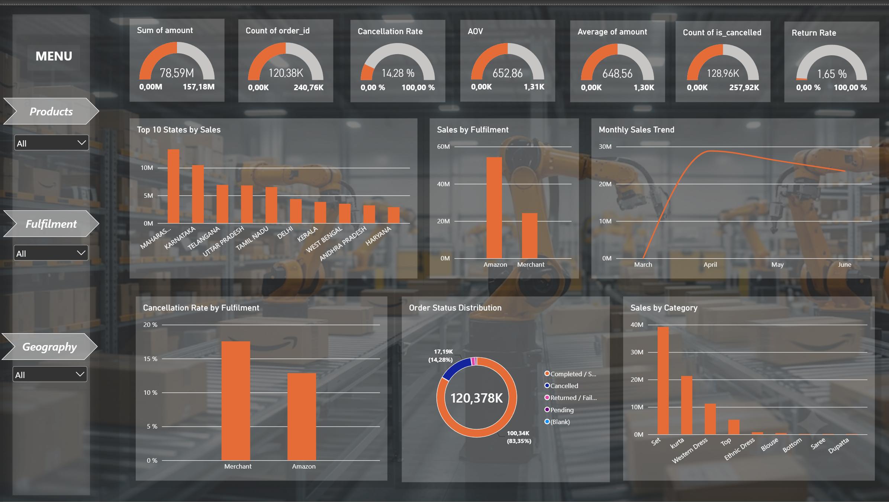

# Amazon_Sale_Report — End-to-End Data Analysis

An end-to-end **Junior Data Analyst portfolio project** based on Amazon sales data.

The project demonstrates a complete analytics workflow:

**Raw Data → Data Cleaning → Feature Engineering → Exploratory Data Analysis → SQL Analysis → Power BI Dashboard → Business Insights**

## Tools

- Python
- Pandas
- NumPy
- Jupyter Notebook
- SQL / SQLite
- Excel
- Power BI

## Project Structure

```text
Amazon_Sale_Report/
│
├── README.md
├── .gitignore
│
├── data/
│   ├── raw/
│   │   └── README.md
│   │
│   └── cleaned/
│       ├── Amazon_Sale_Report_Cleaned.csv
│       ├── Amazon_Sale_Report_Cleaned.xlsx
│       └── README.md
│
├── notebooks/
│   ├── Amazon_Sale_Report_Analysis.ipynb
│   ├── Create_Amazon_Sale_Report_DB.ipynb
│   └── Amazon_Sale_Report_SQL.ipynb
│
├── sql/
│   └── Amazon_Sale_Report_Queries.sql
│
├── dashboard/
│   ├── Amazon_Sale_Report_Dashboard.pbix
│   └── Amazon_Sale_Report_Dashboard.png
│
└── outputs/
    └── kpi/
```

## Workflow

### 1. Data Cleaning

The raw Amazon sales dataset is cleaned and prepared using Python/Pandas.

Main steps include:

- Handling missing values
- Standardizing column names
- Converting data types
- Cleaning categorical values
- Creating date-related features
- Identifying cancelled/returned orders
- Creating analytical flags and derived metrics

### 2. Exploratory Data Analysis

The Python analysis examines:

- Sales trends
- Product/category performance
- Customer segments
- Fulfilment
- Geography
- Order status
- Product size
- B2B activity
- Monthly and yearly KPIs

### 3. SQL Analysis

The cleaned data is loaded into SQLite.

The SQL section demonstrates analytical SQL techniques such as:

- Aggregations
- GROUP BY
- CASE
- CTEs
- Window functions
- Ranking
- Time-based analysis
- Comparative KPI analysis

To recreate the database, run:

```text
notebooks/Create_Amazon_Sale_Report_DB.ipynb
```

This creates the local SQLite file `data/cleaned/Amazon_Sale_Report.db`. The database is intentionally excluded from Git because it can be reproduced from the cleaned CSV.

The database itself is ignored by Git and can be regenerated from the cleaned dataset.

### 4. Power BI Dashboard

The final dashboard presents the main business KPIs and analytical findings in an interactive format.



## Reproducibility

Recommended order:

1. Run `Amazon_Sale_Report_Analysis.ipynb`
2. Run `Create_Amazon_Sale_Report_DB.ipynb`
3. Run `Amazon_Sale_Report_SQL.ipynb`
4. Open `dashboard/Amazon_Sale_Report_Dashboard.pbix`

## Portfolio Focus

This project demonstrates practical skills in:

- Data cleaning
- Exploratory data analysis
- Data transformation
- Feature engineering
- SQL analytics
- KPI development
- Business-oriented analysis
- Data visualization
- Power BI dashboard development
- Reproducible analytical workflows

## Author

**JK — Junior Data Analyst Portfolio**
